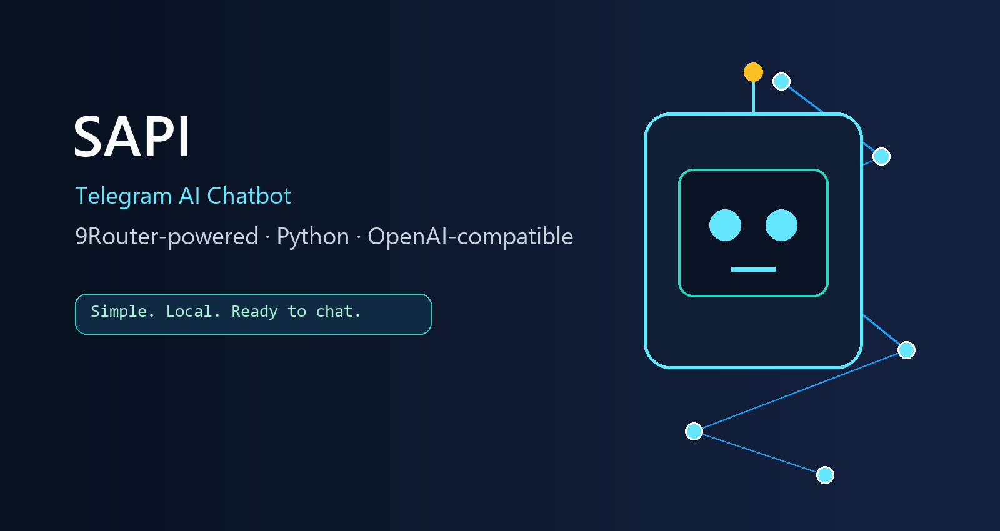
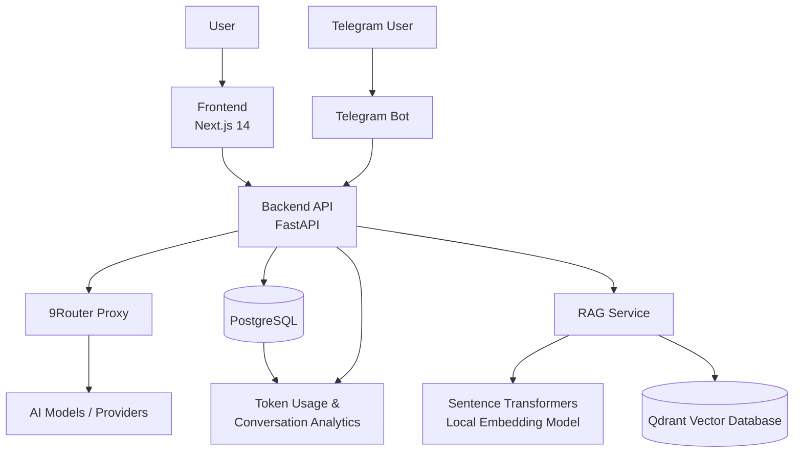

<p align="center">
  
</p>

# SAPI — Chatbot AI Telegram berbasis 9Router

SAPI adalah chatbot AI yang dapat digunakan melalui Telegram. Repository ini bukan hanya dokumentasi: `bot.py` adalah implementasi chatbot yang dapat langsung dijalankan. Proyek ini menggunakan **9Router** sebagai gateway AI lokal dan menyediakan Hermes Agent sebagai jalur alternatif.

> 9Router dijalankan sebagai gateway lokal yang kompatibel dengan OpenAI API.

## Tujuan

- Membuat chatbot AI yang bisa dicoba pengguna lain.
- Menjelaskan requirement, instalasi 9Router, konfigurasi model, dan koneksi Telegram.
- Menyediakan troubleshooting untuk masalah umum.

## Alur sistem

```text
Pengguna Telegram
      ↓
Telegram Bot API
      ↓
bot.py
      ↓
9Router lokal (localhost:20128/v1)
      ↓
Provider/model AI yang dipilih di 9Router
```

Hermes Agent bukan dependency wajib untuk `bot.py`. Pilih salah satu jalur agar token Telegram tidak dipakai dua proses.

## Requirement

- Windows 10/11, macOS, Linux, atau WSL2.
- Node.js/npm untuk 9Router.
- Python 3.11+.
- Git dan koneksi internet.
- Provider AI atau subscription yang dikonfigurasi di 9Router.
- Akun Telegram dan bot token dari [@BotFather](https://t.me/BotFather).

## Instalasi cepat

```bash
git clone https://github.com/achmadnabillaabas/Chat-Bot-AI-Asistant.git
cd Chat-Bot-AI-Asistant
npm install -g 9router
9router
```

Buka dashboard 9Router di `http://localhost:20128/dashboard`, konfigurasi provider/model, lalu ikuti:

1. [Requirement](docs/REQUIREMENTS.md)
2. [Instalasi](docs/INSTALLATION.md)
3. [Konfigurasi 9Router](docs/PROVIDER_SETUP.md)
4. [Konfigurasi Hermes opsional](docs/HERMES_SETUP.md)
5. [Telegram Bot](docs/TELEGRAM_SETUP.md)
6. [Menjalankan chatbot](docs/USAGE.md)
7. [Troubleshooting](docs/TROUBLESHOOTING.md)

## Jalankan chatbot

Linux/macOS/WSL2:

```bash
export ROUTER9_BASE_URL="http://localhost:20128/v1"
export ROUTER9_API_KEY="your-local-9router-key"
export ROUTER9_MODEL="auto"
export TELEGRAM_BOT_TOKEN="123456:..."
python3 bot.py
```

Windows PowerShell:

```powershell
$env:ROUTER9_BASE_URL="http://localhost:20128/v1"
$env:ROUTER9_API_KEY="your-local-9router-key"
$env:ROUTER9_MODEL="auto"
$env:TELEGRAM_BOT_TOKEN="123456:..."
python bot.py
```

## Keamanan

Jangan commit API key, token Telegram, password, atau `.env`. Jika credential bocor, cabut melalui 9Router/provider atau BotFather dan buat credential baru.

## Pengembangan

- [Rencana proyek](PROJECT_PLAN.md)
- [To-do list](TODO.md)

## Lisensi

Lisensi proyek belum ditentukan.


---


## AI Assistant Dashboard
Arsitektur sistem


Docker: menjalankan layanan pendukung seperti PostgreSQL dan Qdrant.
RAG: mengambil potongan dokumen yang relevan sebelum konteks dikirim ke AI.
Telegram Bot: menjadi jalur interaksi alternatif selain dashboard web.

## Cara kerja sistem
1. Pengguna memasukkan prompt. Misalnya meminta AI menulis artikel mengenai dampak kesehatan pola makan berbasis tumbuhan.

2. Frontend mengirim prompt ke backend. Prompt beserta konfigurasi yang diperlukan diproses melalui API.

3. Backend meneruskan permintaan ke 9Router. Sistem menggunakan AI Combo yang dipilih dan tidak harus menggunakan model individual secara langsung.

4. AI menghasilkan jawaban. Respons dikembalikan ke pengguna melalui dashboard.

5. Sistem menyimpan data dan penggunaan token. Catatan penggunaan mencakup input token dan output token, sesuai data yang tersedia dari respons AI.

6. Pengguna dapat memeriksa hasilnya. Riwayat percakapan dan halaman Token Usage membantu melihat interaksi serta konsumsi token.

# AI Assistant Dashboard

**Personal AI Assistant with 9Router Integration, Conversation Management, Token Analytics, Knowledge Base, and RAG**

AI Assistant Dashboard adalah aplikasi asisten AI berbasis web yang mengintegrasikan antarmuka percakapan, model AI melalui 9Router, penyimpanan riwayat percakapan, analitik penggunaan token, serta sistem Knowledge Base untuk mendukung pencarian informasi dari dokumen milik pengguna.

Proyek ini dikembangkan menggunakan arsitektur frontend dan backend terpisah, dengan PostgreSQL sebagai database utama, Qdrant sebagai vector database untuk kebutuhan Retrieval-Augmented Generation (RAG), dan Docker untuk menjalankan layanan pendukung.

## Daftar Isi

- [Overview](#overview)
- [Fitur Utama](#fitur-utama)
- [Arsitektur Sistem](#arsitektur-sistem)
- [Teknologi yang Digunakan](#teknologi-yang-digunakan)
- [Dashboard AI Assistant](#dashboard-ai-assistant)
- [Integrasi 9Router](#integrasi-9router)
- [Database PostgreSQL](#database-postgresql)
- [Knowledge Base dan RAG](#knowledge-base-dan-rag)
- [Integrasi Telegram Bot](#integrasi-telegram-bot)
- [Pencatatan dan Analitik Token](#pencatatan-dan-analitik-token)
- [Struktur Proyek](#struktur-proyek)
- [Menjalankan Aplikasi](#menjalankan-aplikasi)
- [Konfigurasi Environment](#konfigurasi-environment)
- [Keamanan](#keamanan)
- [Pengembangan Selanjutnya](#pengembangan-selanjutnya)

## Overview

Proyek ini bertujuan membangun asisten AI pribadi melalui satu dashboard terpusat. Pengguna dapat berinteraksi dengan model AI, mengelola percakapan, memanfaatkan dokumen sebagai sumber pengetahuan, dan memantau penggunaan token.

Sistem menggunakan **9Router sebagai lapisan integrasi model AI**, sehingga pemilihan model atau konfigurasi AI dapat dilakukan melalui mekanisme routing yang disediakan 9Router.

Di sisi backend, FastAPI menangani komunikasi API, logika aplikasi, pengelolaan data, serta integrasi dengan layanan pendukung. PostgreSQL menyimpan data terstruktur, sedangkan Qdrant menyimpan representasi vektor dokumen untuk proses pencarian semantik.

## Fitur Utama

### 1. AI Chat Dashboard
- Antarmuka chat dengan tema dark mode.
- Membuat dan mengelola percakapan.
- Menyimpan riwayat pesan.
- Memilih konfigurasi AI melalui AI Combo.
- Quick Search untuk membantu menemukan percakapan.
- Menampilkan informasi penggunaan token pada percakapan.

### 2. AI Model Routing
- Integrasi dengan 9Router Proxy.
- Pemilihan konfigurasi AI melalui AI Combo.
- Pemisahan dashboard aplikasi dari layanan routing model AI.
- Pemantauan status koneksi 9Router.

### 3. Token Usage Analytics
- Mencatat jumlah input token.
- Mencatat jumlah output token.
- Menghitung total token.
- Menghubungkan penggunaan token dengan percakapan dan pesan.
- Menyediakan data untuk pemantauan penggunaan model AI.

### 4. Knowledge Base
- Mengelola kumpulan dokumen berdasarkan Knowledge Base.
- Mengunggah dokumen untuk diproses.
- Menggunakan dokumen sebagai sumber informasi untuk pencarian.
- Mengisolasi dokumen berdasarkan Knowledge Base.

### 5. Retrieval-Augmented Generation (RAG)
- Mengubah dokumen menjadi embedding.
- Menyimpan embedding di Qdrant.
- Melakukan pencarian semantik berdasarkan pertanyaan pengguna.
- Menggunakan potongan dokumen yang relevan sebagai konteks jawaban AI.
- Mendukung penggunaan chat dengan RAG aktif atau nonaktif.

### 6. Telegram Bot
- Integrasi bot Telegram dengan backend.
- Pemrosesan pesan melalui mekanisme polling.
- Penyimpanan percakapan Telegram.
- Pencatatan penggunaan token dari permintaan yang diproses.

### 7. Layanan Pendukung
- PostgreSQL untuk penyimpanan data terstruktur.
- Qdrant untuk penyimpanan dan pencarian vektor.
- pgAdmin untuk membantu administrasi PostgreSQL.
- Docker Compose untuk menjalankan layanan database dan pendukung.

## Arsitektur Sistem

Sistem menggunakan arsitektur berlapis yang memisahkan antarmuka pengguna, backend aplikasi, layanan AI, dan penyimpanan data.



### Alur kerja sistem

1. Pengguna mengirim pesan melalui dashboard atau Telegram.
2. Backend menerima permintaan dan memproses konteks percakapan.
3. Jika RAG diaktifkan, backend mencari informasi relevan dari Knowledge Base menggunakan Qdrant.
4. Backend mengirim permintaan ke konfigurasi model AI melalui 9Router.
5. Model menghasilkan jawaban, kemudian backend mengembalikannya ke antarmuka pengguna.
6. Data percakapan dan penggunaan token disimpan di PostgreSQL sesuai mekanisme pencatatan aplikasi.

**Catatan:** Diagram ini menunjukkan alur arsitektur konseptual. Urutan internal pemrosesan, pemanggilan layanan, dan transaksi database dapat berbeda sesuai implementasi kode.

## Teknologi yang Digunakan

| Komponen | Teknologi | Peran |
|---|---|---|
| Frontend | Next.js 14 | Antarmuka dashboard dan chat |
| Frontend language | TypeScript | Pengembangan antarmuka dengan tipe data |
| Styling | Tailwind CSS | Styling dan layout responsif |
| Backend | Python, FastAPI | API dan logika aplikasi |
| Backend validation | Pydantic | Validasi data dan konfigurasi |
| Relational database | PostgreSQL 16 | Penyimpanan data terstruktur |
| Vector database | Qdrant | Penyimpanan embedding dan pencarian vektor |
| AI routing | 9Router Proxy | Routing permintaan ke model AI |
| Embedding | Sentence Transformers | Membuat representasi vektor dokumen |
| Embedding model | `paraphrase-multilingual-MiniLM-L12-v2` | Embedding multilingual dengan dimensi 384 |
| Containerization | Docker | Menjalankan layanan dalam container |
| Orchestration | Docker Compose | Mengelola beberapa layanan |
| Database migration | Alembic | Mengelola perubahan skema database |
| Telegram integration | Telegram Bot API | Integrasi komunikasi melalui Telegram |

## Dashboard AI Assistant


Dashboard merupakan antarmuka utama untuk berinteraksi dengan sistem.

### Chat Workspace

Halaman chat menyediakan pemilihan AI Combo, pengaturan RAG, pemilihan Knowledge Base, dan area percakapan. Sidebar memuat navigasi ke fitur utama dan daftar percakapan terbaru.

### Navigation

Dashboard memiliki halaman atau bagian utama berikut:

- **Chat:** berinteraksi dengan AI.
- **Knowledge Base:** mengelola kumpulan dokumen.
- **Token Usage:** melihat penggunaan token.
- **Models & 9Router:** mengelola atau memantau konfigurasi model dan routing.
- **Telegram Bot:** konfigurasi dan integrasi bot.
- **Settings:** pengaturan aplikasi.

Ketersediaan detail pengaturan bergantung pada implementasi masing-masing halaman.

### Desain Antarmuka

Dashboard menggunakan pendekatan **Syntactic Slate Design System**, dengan karakteristik:

- Dark slate sebagai palet warna utama.
- Tipografi Inter dan JetBrains Mono untuk tampilan antarmuka dan informasi teknis.
- Border yang tegas dan hierarki visual yang jelas.
- Penggunaan gradient, glow, dan efek dekoratif secara terbatas.
- Layout yang berorientasi pada produktivitas dan keterbacaan.

## Integrasi 9Router


9Router Proxy berfungsi sebagai lapisan routing yang menghubungkan backend aplikasi dengan model AI yang dikonfigurasi melalui 9Router.

Pada proyek ini, backend menggunakan service integrasi 9Router, termasuk `ninerouter_service.py`, untuk menangani komunikasi dengan layanan tersebut.

### Peran 9Router

- Menyediakan jalur akses ke model AI yang tersedia.
- Memungkinkan pemilihan konfigurasi model melalui AI Combo.
- Memisahkan logika dashboard dari konfigurasi provider model.
- Menyediakan informasi penggunaan atau request melalui antarmuka Usage & Analytics 9Router.

### AI Combo

AI Combo merupakan mekanisme pemilihan konfigurasi AI pada dashboard. Salah satu konfigurasi yang digunakan dalam pengujian adalah `combowombojumbo`.

Konfigurasi aktual, model yang dipilih, dan provider yang digunakan mengikuti pengaturan di 9Router.

### Monitoring Penggunaan

Antarmuka Usage & Analytics pada 9Router menampilkan informasi request dan penggunaan token. Data ini dapat digunakan untuk membandingkan penggunaan model, mengamati pola input dan output, serta mengevaluasi efisiensi prompt.

Data pada dashboard aplikasi dan data pada 9Router tidak harus identik jika keduanya menggunakan mekanisme pencatatan, konteks, atau definisi token yang berbeda.

## Database PostgreSQL


PostgreSQL merupakan database relasional utama yang digunakan untuk menyimpan data aplikasi, termasuk percakapan, pesan, konfigurasi, dan penggunaan token.

Database berjalan dalam container Docker dengan nama `ai-assistant-postgres`.

### Tabel utama

Berdasarkan struktur database proyek, tabel yang digunakan meliputi:

| Tabel | Fungsi |
|---|---|
| `users` | Data pengguna |
| `conversations` | Metadata percakapan |
| `messages` | Pesan pengguna dan respons AI |
| `models` | Informasi model atau konfigurasi model |
| `token_usage` | Catatan penggunaan token |
| `knowledge_bases` | Metadata Knowledge Base |
| `documents` | Metadata dokumen yang diunggah |
| `document_chunks` | Potongan dokumen untuk pemrosesan RAG |
| `telegram_config` | Konfigurasi integrasi Telegram |

Hubungan antartabel menggunakan kolom identitas dan foreign key sesuai skema database yang diterapkan.

### Token Usage Schema

Tabel `token_usage` menyimpan informasi penggunaan token per request atau pesan. Kolom yang terlihat pada struktur database meliputi:

| Kolom | Tipe data | Keterangan |
|---|---|---|
| `id` | `integer` | Primary key |
| `user_id` | `integer` | Identitas pengguna |
| `conversation_id` | `integer` | Identitas percakapan |
| `message_id` | `integer` | Identitas pesan terkait |
| `model` | `character varying` | Nama model |
| `input_tokens` | `integer` | Jumlah input token |
| `output_tokens` | `integer` | Jumlah output token |
| `total_tokens` | `integer` | Total token |
| `request_type` | `character varying` | Jenis permintaan, misalnya `chat` |

Kolom dan constraint lengkap tetap mengikuti definisi skema database aktual.

### Mengapa PostgreSQL?

PostgreSQL digunakan karena mendukung penyimpanan data terstruktur, relasi antartabel, transaksi, dan query analitik. Karakteristik tersebut sesuai untuk aplikasi yang membutuhkan riwayat percakapan serta pencatatan penggunaan model AI.

### Administrasi Database

pgAdmin disediakan sebagai antarmuka administrasi PostgreSQL. Database dapat diakses secara lokal melalui konfigurasi port yang digunakan oleh Docker Compose.

**Penting:** kredensial database sebaiknya disimpan melalui environment variable dan tidak ditulis langsung ke repository publik.

## Knowledge Base dan RAG

Retrieval-Augmented Generation (RAG) memungkinkan model AI menggunakan informasi dari dokumen yang disimpan pada Knowledge Base.

RAG memadukan pencarian informasi dengan generasi jawaban sehingga respons dapat didasarkan pada konteks dokumen yang relevan.

### Alur pemrosesan dokumen

1. Pengguna membuat atau memilih Knowledge Base.
2. Dokumen diunggah ke aplikasi.
3. Backend memproses dokumen menjadi potongan teks.
4. Model embedding mengubah potongan teks menjadi vektor berdimensi 384.
5. Vektor dan informasi yang diperlukan untuk pencarian disimpan di Qdrant.
6. Saat pengguna mengajukan pertanyaan dengan RAG aktif, sistem mencari potongan dokumen yang relevan.
7. Potongan yang ditemukan digunakan sebagai konteks bagi model AI.

### Komponen RAG

- **Knowledge Base:** mengelompokkan dokumen.
- **Document Processing:** mengekstrak dan membagi isi dokumen.
- **Sentence Transformers:** membuat embedding secara lokal.
- **Qdrant:** menyimpan vektor dan mendukung pencarian semantik.
- **9Router:** meneruskan permintaan generasi jawaban ke model AI yang dikonfigurasi.

Model embedding lokal yang digunakan adalah `sentence-transformers/paraphrase-multilingual-MiniLM-L12-v2`, dengan dimensi embedding 384.

### Mode RAG

- **RAG OFF:** pertanyaan diproses tanpa mengambil konteks dari Knowledge Base.
- **RAG ON:** sistem mencari konteks relevan dari Knowledge Base yang dipilih.

Kualitas jawaban RAG dipengaruhi oleh isi dokumen, proses pemotongan teks, embedding, parameter pencarian, dan kemampuan model dalam menggunakan konteks.

## Integrasi Telegram Bot

Telegram Bot digunakan sebagai kanal interaksi tambahan selain dashboard web.

Backend menangani komunikasi bot melalui mekanisme long polling, memproses pesan masuk, dan menghubungkannya dengan logika percakapan aplikasi.

Komponen integrasi meliputi:

- Konfigurasi Telegram Bot.
- Pemrosesan pesan masuk.
- Pengelolaan konteks percakapan.
- Penyimpanan data percakapan.
- Pencatatan penggunaan token.

Token bot Telegram harus disimpan secara aman di konfigurasi lokal atau environment variable dan tidak boleh dipublikasikan di repository.

## Pencatatan dan Analitik Token

Penggunaan token menjadi salah satu metrik utama dalam evaluasi sistem.

Aplikasi mencatat input token, output token, dan total token untuk membantu memantau pemakaian model AI.

### Metrik

- **Input Tokens:** token yang digunakan untuk input model, termasuk konteks yang dikirim sesuai mekanisme provider.
- **Output Tokens:** token yang dihasilkan model.
- **Total Tokens:** jumlah input dan output token berdasarkan pencatatan aplikasi.

Secara konseptual:

`total_tokens = input_tokens + output_tokens`

Rumus tersebut berlaku ketika ketiga nilai dicatat menggunakan definisi dan satuan yang sama.

### Tujuan analitik

- Memantau konsumsi token.
- Membandingkan penggunaan antarpermintaan.
- Mengevaluasi efisiensi prompt.
- Mengamati perbedaan penggunaan token antar-model atau konfigurasi AI.
- Menjadi dasar untuk pengembangan analitik biaya dan optimasi penggunaan model.

Jumlah token dapat dipengaruhi oleh panjang prompt, riwayat percakapan, system prompt, konteks RAG, model yang digunakan, dan mekanisme penghitungan token pada provider.

## Struktur Proyek

Struktur konseptual repository:

```text
ai-assistant-dashboard/
├── backend/
│   ├── app/
│   │   ├── main.py
│   │   └── services/
│   │       └── ninerouter_service.py
│   ├── alembic/
│   ├── uploads/
│   ├── venv/
│   └── requirements.txt
├── frontend/
│   ├── app/
│   ├── components/
│   ├── public/
│   ├── package.json
│   └── ...
├── docker-compose.yml
├── .gitignore
└── README.md
```

Struktur di atas merupakan gambaran komponen utama, bukan inventaris lengkap seluruh file. Lokasi modul dan nama direktori lain mengikuti kondisi repository aktual.

Folder `venv`, `node_modules`, hasil build, file `.env`, dan cache model lokal tidak perlu dimasukkan ke Git.

## Menjalankan Aplikasi

### Prasyarat

- Windows dengan Docker Desktop dan WSL 2.
- Python 3.11.
- Node.js dan npm.
- Git.
- Akses dan konfigurasi 9Router.
- Environment variable yang diperlukan backend dan frontend.

### 1. Clone repository

```bash
git clone <REPOSITORY_URL>
cd <NAMA_FOLDER_REPOSITORY>
```

Ganti placeholder dengan URL dan nama folder repository aktual.

### 2. Jalankan layanan Docker

Dari direktori proyek:

```bash
docker compose up -d
```

Periksa status container:

```bash
docker ps -a
```

### 3. Jalankan backend

Buka terminal baru:

```powershell
cd "C:\ai asistant-sistem cerdas\backend"
.\venv\Scripts\python.exe -m uvicorn app.main:app --host 127.0.0.1 --port 8000 --log-level info
```

Backend berjalan pada:

- API: `http://localhost:8000`
- Health check: `http://localhost:8000/health`
- API documentation: `http://localhost:8000/docs`

### 4. Jalankan frontend

Buka terminal baru:

```powershell
cd "C:\ai asistant-sistem cerdas\frontend"
npm run dev
```

Dashboard dapat diakses melalui:

`http://localhost:3000`

### 5. Verifikasi layanan

Periksa endpoint health backend dan status container. Pastikan PostgreSQL, Qdrant, dan 9Router dapat dijangkau sebelum melakukan pengujian chat atau RAG.

Alamat, port, nama container, serta perintah startup perlu disesuaikan jika konfigurasi lokal berbeda.

## Konfigurasi Environment

Aplikasi membutuhkan konfigurasi environment untuk menghubungkan backend dengan database dan layanan eksternal.

Variabel yang mungkin diperlukan meliputi:

- URL dan kredensial PostgreSQL.
- API key 9Router.
- URL layanan 9Router.
- Konfigurasi Qdrant.
- Token bot Telegram.
- URL backend yang digunakan frontend.
- Pengaturan autentikasi aplikasi.

Nama variabel yang sebenarnya harus mengikuti konfigurasi di source code dan file environment proyek.

Gunakan `.env.example` untuk mendokumentasikan nama variabel tanpa menyertakan nilai rahasia.

Jangan commit file `.env` yang berisi API key, token bot, password database, atau kredensial lainnya.

## Keamanan

Beberapa praktik keamanan yang perlu diterapkan:

- Jangan menyimpan API key atau password langsung dalam source code.
- Jangan mengunggah `.env` ke repository publik.
- Gunakan `.gitignore` untuk mengecualikan file rahasia dan artefak lokal.
- Batasi port database agar tidak terbuka ke jaringan yang tidak diperlukan.
- Gunakan autentikasi dan otorisasi untuk endpoint yang sensitif.
- Hindari mencatat token rahasia ke log.
- Tinjau pengaturan foreign key dan kebijakan penghapusan data sebelum mengubah atau menghapus percakapan.
- Simpan backup database sebelum menjalankan migrasi yang berisiko.

Jika kredensial pernah terpublikasi, lakukan rotasi kredensial tersebut dan perbarui konfigurasi lokal.

## Status Proyek

Proyek ini menggabungkan dashboard chat AI, routing model melalui 9Router, penyimpanan PostgreSQL, analitik token, integrasi Telegram, dan sistem Knowledge Base berbasis RAG.

Fokus pengembangannya adalah membangun asisten AI yang modular, dapat dipantau, dan dapat dikembangkan lebih lanjut melalui integrasi model AI serta sumber pengetahuan tambahan.

---

**Catatan:** README ini mendokumentasikan arsitektur dan komponen proyek berdasarkan informasi yang tersedia. Sebelum dipublikasikan, sesuaikan nama repository, URL, daftar environment variable, struktur direktori, dan fitur yang benar-benar sudah tersedia dengan source code terbaru.
