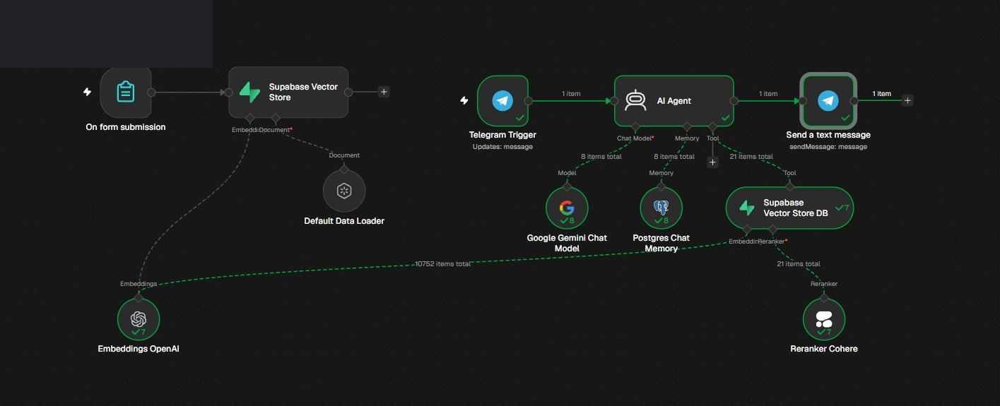
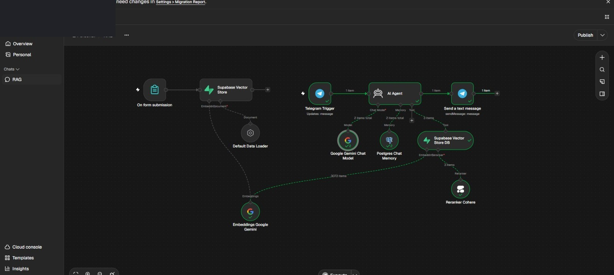
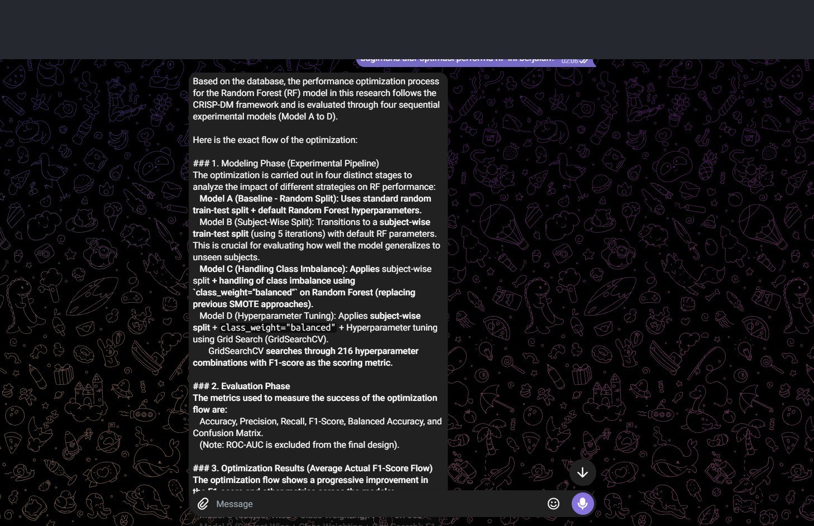
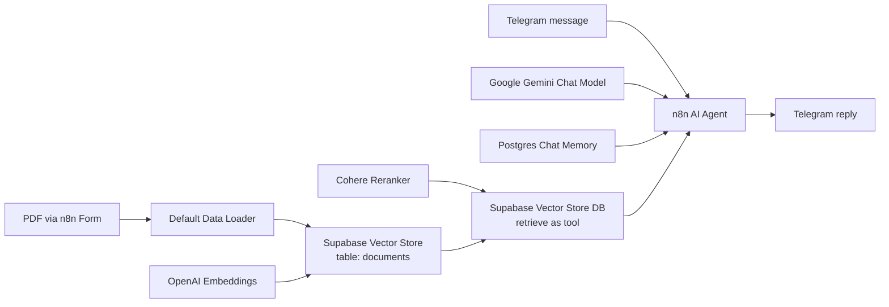

# Eksperimen RAG chatbot dengan n8n

Dokumen ini mencatat eksperimen chatbot berbasis Retrieval-Augmented Generation (RAG) menggunakan n8n. Ini adalah **rekomendasi dan workflow eksperimen**, bukan fitur yang sudah terpasang pada `bot.py`. Bot SAPI saat ini tetap menggunakan integrasi 9Router yang ada; mengaktifkan workflow n8n memerlukan deployment dan konfigurasi layanan secara terpisah.

Ekspor workflow asli disimpan di luar repository pada `C:\Users\Bang_megg\Documents\tugas pak risty\smt 7\RAG\RAG-sapi.json`. Ekspor memuat referensi nama credential n8n, bukan nilai rahasia. Jangan menyalin token atau credential ke repository.

## Ringkasan workflow percobaan

Workflow bernama `RAG` terdiri dari dua jalur:

1. **Ingestion dokumen:** form n8n menerima berkas PDF, `Default Data Loader` menyiapkan konten dokumen, lalu node `Embeddings OpenAI` menghasilkan embedding. `Supabase Vector Store` menyimpan dokumen pada tabel `documents`.
2. **Tanya-jawab Telegram:** `Telegram Trigger` menerima pesan, kemudian `AI Agent` menggunakan `Google Gemini Chat Model` untuk jawaban, `Supabase Vector Store DB` sebagai tool retrieval, `Reranker Cohere`, dan `Postgres Chat Memory`. Node Telegram mengirim keluaran agent kembali ke chat yang mengirim pesan.

Pada screenshot revisi, node embedding terlihat sebagai **Embeddings OpenAI v7**, Supabase Vector Store/Vector Store DB sebagai **v7**, Cohere Reranker sebagai **v7**, Google Gemini Chat Model sebagai **v8**, dan Postgres Chat Memory sebagai **v8**. Nama model embedding OpenAI yang dipilih (misalnya model tertentu) tidak terlihat, jadi dokumentasi ini tidak menetapkan nama atau dimensinya.

System message pada ekspor meminta agent menjawab berdasarkan data di vector store, dan menyatakan tidak tahu bila jawabannya tidak ditemukan. Tetap uji perilaku ini dengan pertanyaan yang jawabannya ada dan tidak ada di sumber.

## Komponen dan kebutuhan

| Komponen | Peran | Kebutuhan konfigurasi |
|---|---|---|
| n8n | Menjalankan workflow, form upload, dan Telegram trigger | Instance n8n yang dapat dijangkau; webhook publik/HTTPS diperlukan untuk trigger Telegram pada deployment yang sesuai |
| Supabase | Menyimpan isi dokumen, metadata, dan embedding | Project, tabel `documents`, skema/vector extension yang sesuai dengan node Supabase Vector Store |
| OpenAI | Model embedding dokumen dan kueri | Credential OpenAI di n8n; pilih model dan pastikan dimensi embedding konsisten dengan kolom vector Supabase |
| Google Gemini | Model chat untuk AI Agent | Credential/API access Google Gemini yang disetel di n8n |
| Telegram Bot API | Menerima pertanyaan dan mengirim balasan | Credential bot Telegram yang valid di n8n; pastikan tidak ada proses polling lain yang mengambil update bot yang sama |
| Cohere | Reranking hasil retrieval | Credential Cohere aktif; node dapat dihapus jika reranking tidak dipakai |
| PostgreSQL | Memori percakapan agent | Database dan tabel yang sesuai; credential PostgreSQL di n8n |
| Dokumen sumber | Basis pengetahuan untuk retrieval | Workflow ekspor mengatur form untuk PDF; pastikan ukuran, privasi, dan kualitas ekstraksi diuji |

Ekspor workflow hanya mencantumkan nama credential seperti `Supabase account 2`, `Google Gemini(PaLM) Api account`, `Telegram account`, `Cohere account`, dan `Postgres account`. Credential tersebut tidak ikut dipindahkan sebagai rahasia dan harus dibuat ulang/ditautkan pada instance tujuan. Cocokkan nama model dan dukungan node dengan versi n8n yang dipakai; ekspor mencantumkan `models/gemini-3.5-flash`, yang mungkin perlu disesuaikan dengan model yang tersedia saat deployment.

## Dokumentasi visual

Screenshot berikut berasal dari percobaan n8n dan Telegram. Bilah alamat serta identitas workspace/chat yang tidak diperlukan telah dipotong atau ditutup. Screenshot Supabase tidak disertakan karena menampilkan project ID dan isi dokumen tersimpan. Screenshot workflow terbaru menunjukkan **Embeddings OpenAI**; ekspor JSON `RAG-sapi.json` yang tersedia di folder sumber merupakan versi lebih lama dan masih menunjukkan Gemini untuk embedding.

### Workflow RAG di n8n

*Screenshot revisi menunjukkan jalur ingestion memakai form, Data Loader, OpenAI Embeddings, dan Supabase Vector Store. Jalur tanya-jawab memakai Telegram Trigger, AI Agent dengan Google Gemini Chat Model, Postgres Chat Memory, Supabase Vector Store DB, dan Cohere reranker.*

### Detail eksekusi workflow

*Cuplikan canvas dari percobaan yang memperlihatkan koneksi antar-node. Status dan jumlah item hanya mencerminkan tampilan saat screenshot diambil, bukan jaminan hasil pada setiap eksekusi.*

### Contoh jawaban melalui Telegram

*Contoh respons bot terhadap pertanyaan tentang eksperimen Random Forest/WESAD. Gambar ini menunjukkan contoh percakapan, bukan hasil evaluasi akurasi RAG yang terukur.*

## Alur data

## Struktur data dan hasil observasi

Screenshot percobaan memperlihatkan tabel Supabase `public.documents` dengan kolom `id`, `content`, `metadata`, dan `embedding`. Metadata mencakup lokasi potongan dokumen, sedangkan `embedding` berisi vektor numerik. Screenshot juga memperlihatkan tabel `public.n8n_chat_histories`; skema detail dan keterkaitannya tidak terverifikasi dari screenshot.

Screenshot workflow terbaru menunjukkan ingestion dokumen terpisah dari jalur tanya-jawab Telegram dengan OpenAI Embeddings. Node retrieval pada ekspor lama dikonfigurasi dengan `topK: 20` dan `useReranker: true`; karena ekspor tersebut mendahului revisi embedding, cocokkan kembali nilai dan konfigurasi aktual di n8n. Nilai `topK` bukan klaim bahwa 20 hasil selalu optimal. Ukur relevansi dan latensi pada data sendiri.

Bila model embedding berubah, pastikan dimensi embedding tetap cocok dengan skema Supabase. Jika model atau dimensinya berbeda, buat/konfigurasikan ulang kolom atau tabel vektor yang sesuai dan re-embed dokumen yang sudah ada sebelum query dengan embedding baru; jangan mencampur vektor dari model berbeda dalam ruang vektor yang sama.

## Menjalankan dan menguji eksperimen

1. Siapkan instance n8n dan koneksi HTTPS/webhook yang dibutuhkan Telegram Trigger.
2. Siapkan Supabase dan tabel/indeks vector yang kompatibel dengan jenis serta dimensi embedding yang dipilih.
3. Buat credential OpenAI untuk embedding, Google Gemini untuk chat model, Supabase, Telegram, Cohere (jika dipakai), dan PostgreSQL melalui pengelolaan credential bawaan n8n. Jangan menaruh secret di file workflow, README, atau Git.
4. Import `RAG-sapi.json` melalui antarmuka n8n. Ekspor yang diperiksa berstatus tidak aktif; tinjau node, credential, nama tabel, model, prompt, dan koneksi sebelum mengaktifkan workflow.
5. Jalankan jalur form dengan PDF uji yang tidak sensitif. Pastikan konten, metadata, dan embedding tersimpan di tabel yang benar.
6. Uji Telegram dengan pertanyaan yang jawabannya tercantum dalam dokumen, pertanyaan yang tidak tercantum, dan percakapan berbeda. Pastikan jawaban berpijak pada sumber dan tidak mengarang saat retrieval kosong.
7. Periksa execution log n8n, latency, biaya provider, kualitas chunk/retrieval, dan duplikasi ingestion. Hindari mengirim dokumen rahasia ke provider eksternal tanpa persetujuan dan evaluasi privasi.

Detail ukuran chunk dan konfigurasi embedding tidak ditetapkan dalam dokumen ini karena tidak terlihat/terverifikasi dari ekspor dan screenshot yang tersedia. Jangan menganggap nilai tertentu sebagai konfigurasi eksperimen.

## Hubungan dengan repository SAPI

Workflow ini dapat menjadi prototipe atau rekomendasi arsitektur RAG untuk chatbot. Saat ini tidak ada panggilan webhook n8n yang terdokumentasi sebagai bagian dari `bot.py`, dan workflow tidak dianggap aktif hanya karena file dokumentasinya ada.

Jika kelak mengintegrasikannya ke bot, pilih satu pemilik polling Telegram: n8n atau `bot.py`. Jangan jalankan dua trigger polling untuk bot token yang sama karena keduanya dapat berebut update. Pilihan yang lebih aman adalah satu pihak menerima update Telegram dan meneruskan pertanyaan ke pihak lain lewat webhook/API, dengan timeout, validasi payload, kontrol akses, dan penanganan error.

Workflow n8n juga dapat dipakai hanya untuk ingestion dokumen sementara bot memakai API retrieval terpisah. Tentukan batas integrasi sebelum mengubah `bot.py`; hindari perubahan pada `dashboard-ai/` bila pekerjaan hanya menyasar chatbot Telegram.

## Keamanan dan privasi

- Simpan API key, token Telegram, password database, dan Supabase service key hanya di n8n Credentials atau secret store.
- Jangan commit `.env`, export yang mengandung data pengguna, execution log, atau dokumen sumber privat.
- Batasi akses form upload dan Telegram trigger; gunakan HTTPS serta autentikasi/otorisasi yang sesuai.
- Tinjau retensi data di Supabase, PostgreSQL, dan execution logs n8n.
- Rotasi credential jika pernah terekspos.
